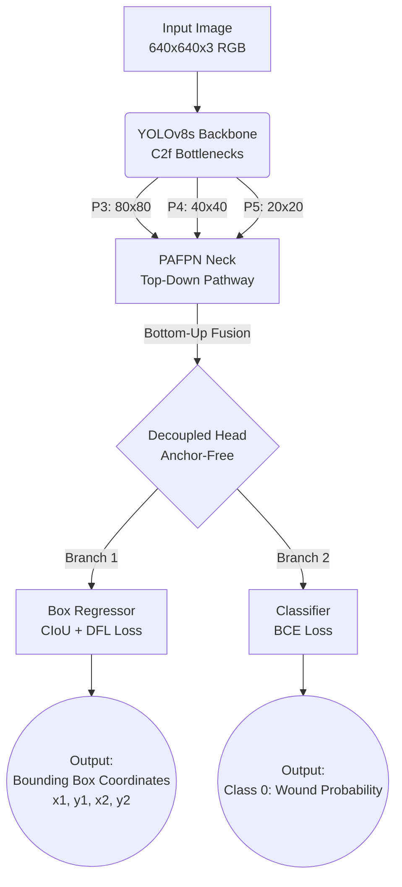

# YOLOv8 Unified Architecture: Image Generation Prompts & Structure

If you are looking to generate or draw an architecture diagram for your presentation, here is the detailed structural breakdown tailored specifically to your **Module 3: Unified Wound Detection (YOLOv8s)** model, along with ready-to-use text prompts for AI image generators (like Midjourney, DALL-E, or Stable Diffusion) and a Mermaid.js diagram.

---

## 1. Structural Breakdown (For Manual/Vector Drawing)
If you are building the graphic in Illustrator, draw.io, or PowerPoint, use this flow:

1. **Input Layer:**
   - Visual: A 3D tensor block representing the clinical photo.
   - Text: `Input Tensor (640 × 640 × 3 RGB)`
2. **Backbone (Feature Extractor):**
   - Visual: A series of shrinking 3D blocks (representing spatial downsampling and channel expansion).
   - Text: `YOLOv8s Backbone (CSPDarknet / C2f Modules)`
   - Detail: Extracts low-level features (fur texture) to high-level features (lesion shapes).
3. **Neck (Feature Aggregation):**
   - Visual: Arrows flowing bottom-up and top-down, fusing different blocks together.
   - Text: `PAFPN (Path Aggregation Feature Pyramid Network)`
   - Detail: Merges multi-scale features to detect both micro-bites and massive burns.
4. **Decoupled Detection Head:**
   - Visual: The network splits into two distinct parallel branches.
   - Branch A (Box): `Bounding Box Regression Branch (CIoU / DFL Loss)` $\rightarrow$ Predicts $[x_1, y_1, x_2, y_2]$
   - Branch B (Class): `Classification Branch (BCE Loss)` $\rightarrow$ Predicts Probability of `Wound` (Class 0)
5. **Output Layer:**
   - Visual: An image of a dog with a tight bounding box around a wound.
   - Text: `Anchor-Free Localization (Output: 1 Class "Wound")`

---

## 2. Mermaid.js Diagram (For direct Markdown/Marp rendering)

---

## 3. Prompts for AI Image Generators (Midjourney / DALL-E)

**Option A: Clean, Academic Blueprint Style**
> **Prompt:** A clean, professional neural network architecture diagram for YOLOv8 object detection. The diagram flows from left to right. On the left, an input tensor representing a 640x640 RGB image. In the middle, a deep learning backbone with interconnected 3D rectangular blocks representing C2f convolution layers, shrinking in size. In the neck, a Feature Pyramid Network with bi-directional arrows merging layers. On the right, the network splits into a decoupled head with two parallel branches: one for bounding box spatial regression, and one for binary classification. Academic, technical blueprint style, vector graphic, flat design, modern data science aesthetics, blue and orange color palette, white background.

**Option B: Modern, 3D Isometric Isometric Tech Style**
> **Prompt:** 3D isometric illustration of a computer vision neural network architecture. At the start, a floating 3D image plane. Data flows through glowing translucent geometric blocks representing convolutional neural network layers. The layers shrink in spatial size but expand in depth. The network features a complex Path Aggregation Network (PAFPN) with glowing data streams mixing features top-down and bottom-up. The final output splits into two distinct floating computational nodes. Modern tech aesthetic, glassmorphism, glowing cyan and purple neon data pathways, dark mode background, high-resolution, 8k, Unreal Engine 5 render style.
